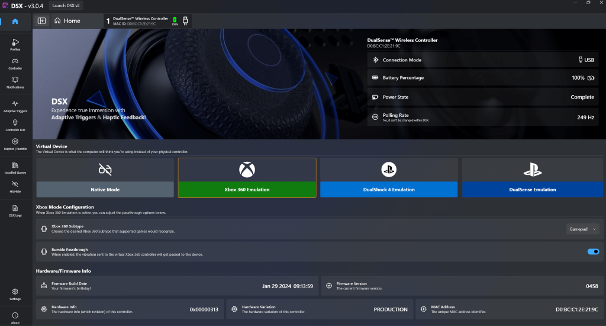
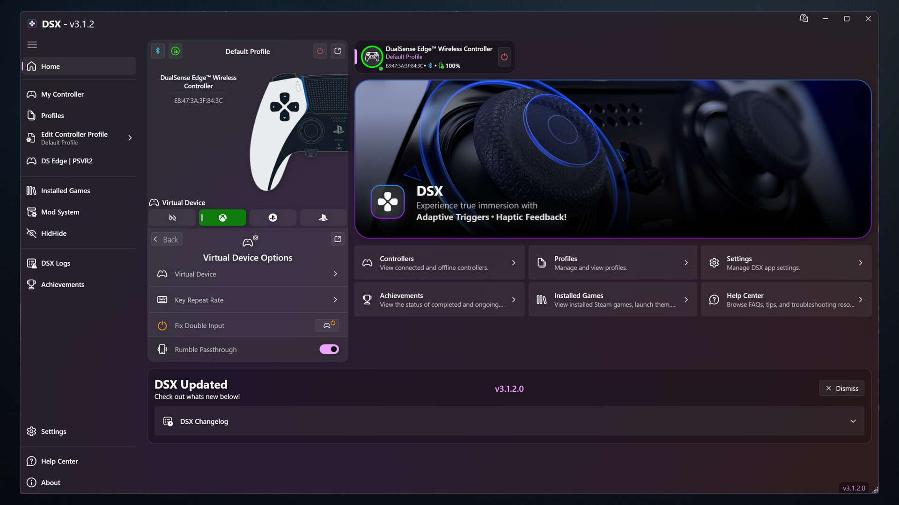
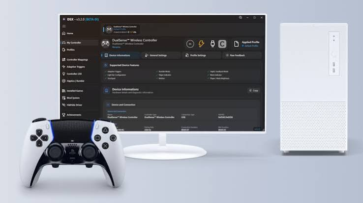

# DSX Puts DualSense Feedback Within Your Control

A controller can register every button correctly while its trigger effects or haptic feedback remain absent.
DSX lets you configure PlayStation controller behavior on PC, with the game, connection, and chosen virtual device determining the result.

[](https://dsx-dualsense.github.io/DSX/)

## Give the Game One Intended Controller

Start with the controller identity the game expects.
A title designed around XInput may need an Xbox-style virtual controller.
A game with native PlayStation support may require a different route to retain its controller-specific feedback.

Use the [DSX Steam listing](https://store.steampowered.com/app/1812620/DSX/) for the current product.
The [Paliverse repository](https://github.com/Paliverse/DualSenseX) states that the old GitHub release, version 1.4.9, is no longer maintained.
Keep that distinction visible when following an older tutorial.

Choose a reproducible baseline:

1. Connect one controller.
2. Select the intended output mode.
3. Confirm that its buttons and axes reach the game.
4. Test a short, repeatable scene.
5. Add feedback and remapping changes individually.

A successful connection is the beginning of this check.
The game must receive the device identity and input format it supports.
An icon changing to an Xbox symbol does not establish that native DualSense effects are active.

DualSenseY's [controllerEmulation.cpp](source/controllerEmulation.cpp) and [controllerEmulation.hpp](include/controllerEmulation.hpp) illustrate virtual Xbox 360 and DualShock 4 output.
Its controller settings are represented by [scePadSettings.cpp](source/scePadSettings.cpp) and [scePadSettings.hpp](include/scePadSettings.hpp).
Application-wide preferences are handled separately in [appSettings.cpp](source/appSettings.cpp) and [appSettings.hpp](include/appSettings.hpp).

## Shape Trigger Resistance Around the Action

Adaptive triggers alter the feel of a pull.
They are separate from the controller's main vibration actuators and from the button value reported to a game.
A static resistance setting can therefore work while game-driven effects remain absent.



Begin with a neutral setting on both sides.
Change one trigger, test the same action, and return to neutral before trying another effect.
Keep the setting comfortable for the action you repeat most often.

For a driving game, compare the effect during a steady throttle input and a full release.
For another genre, choose a similarly repeatable action.
The purpose is to separate the physical trigger effect from changes in the game's input curve.

### A documented text format from DualSenseX

The older [developer documentation](https://github.com/Paliverse/DualSenseX#for-game-devs) describes case-sensitive trigger-state text.
This example leaves the left trigger normal and requests resistance on the right.

```text
LeftTrigger=Normal
RightTrigger=Resistance
ForceRightTrigger=(2)(3)
```

The resistance parameters must follow the ranges documented for that mode.
Other modes use different parameter counts.
Check the integration interface of the installed DSX version before adapting an older text-file workflow.

The supplied [scePadCustomTriggers.cpp](source/scePadCustomTriggers.cpp) and [scePadCustomTriggers.hpp](include/scePadCustomTriggers.hpp) contain DualSenseY trigger-effect helpers.
Light-bar color handling appears in [led.cpp](source/led.cpp) and [led.hpp](include/led.hpp).
An LED change can confirm an output setting without proving that a game is sending adaptive-trigger events.

## Remove Duplicate Input Before Adjusting Sensitivity

One physical controller can appear alongside a virtual controller.
If the game reads both, a single press may produce two actions.
Changing a stick deadzone does not resolve that duplicate device path.

The [HidHide guide](https://docs.nefarius.at/projects/HidHide/Simple-Setup-Guide/) explains hiding a physical device while allowing the remapping application to read it.
Select the intended physical controller carefully.
Keep the application producing the virtual device on the allowed list.

Check the result in the same game menu:

- One press should move one menu item.
- The selected virtual controller should remain available.
- DSX should continue receiving physical input.
- A disconnected controller should disappear as expected.
- Reconnecting should restore the intended route.

Review the game's Steam Input setting as part of this route.
Avoid adding multiple translation layers without identifying which one supplies the final device.
Test each arrangement independently before keeping it.

For button-to-desktop behavior, DualSenseY has [keyboardMouseMapper.cpp](source/keyboardMouseMapper.cpp) and [keyboardMouseMapper.hpp](include/keyboardMouseMapper.hpp).
Button-combination helpers are in [controllerHotkey.cpp](source/controllerHotkey.cpp) and [controllerHotkey.hpp](include/controllerHotkey.hpp).
Its single-instance check is represented by [appMutex.cpp](source/appMutex.cpp) and [appMutex.hpp](include/appMutex.hpp).

A hotkey, a keyboard mapping, and a virtual gamepad button can all affect the same action.
Check those assignments when a duplicate remains after the device route is corrected.
Keep only the combination that produces the intended result.

## Trace Feedback Back to Its Producer

The word vibration can describe several different effects.
Identify whether the signal comes from ordinary game rumble, audio conversion, native DualSense support, or a game-specific integration.
Then test that signal rather than relying on a general controller test.

| Feedback path | Signal producer | What to observe | What it does not establish |
| --- | --- | --- | --- |
| Ordinary rumble | Game controller output | Vibration during a known event | Native DualSense haptic support |
| Audio-derived feedback | Selected audio source | Response to the chosen sound | Game-specific trigger logic |
| Static trigger setting | Application configuration | Resistance during a pull | A changing in-game effect |
| Native controller feedback | Compatible game's device output | Effects in a supported scene | Compatibility with every title |
| Mod-driven feedback | A compatible game integration | Events reflected by the integration | Support from an unrelated mod format |

The [DSX+ listing](https://store.steampowered.com/app/2345650/) describes Virtual DualSense and Bluetooth audio/haptic features.
It also contains development-status qualifications for audio and haptic passthrough.
Check the installed version's release notes and available options before assuming that a feature is present on every release branch.



Use USB as one controlled test arrangement, then compare Bluetooth with the same game and settings.
Record which feedback path works on each connection.
A working Bluetooth button connection alone does not demonstrate that every audio or feedback path is active.

In DualSenseY, [audioPassthrough.cpp](source/audioPassthrough.cpp) and [audioPassthrough.hpp](include/audioPassthrough.hpp) contain audio-processing components.
Those components illustrate an additional signal path beyond button reporting.
Use the receiving application's settings to establish which audio source is actually being processed.

### Check ownership when a virtual option stays locked

DSX+ requires the base DSX application.
Its Steam page describes a Sync action for refreshing DLC ownership when activation is not reflected in the application.
Follow the instructions for the installed version and verify the selected mode again.

Do not use an old screenshot as the sole reference for an option's location.
Menu names and feature availability can change between releases.
Keep the release number with a configuration note.

## Make a Game Profile Explain Its Own Purpose

Name a configuration for its intended game and output behavior.
Record the connection type, virtual controller choice, and feedback path alongside it.
This makes a profile easier to evaluate after changing a cable, game setting, or application version.



A useful profile note answers:

- Which executable is being played?
- Which physical controller is selected?
- Which virtual device should the game receive?
- Are triggers static, native, or integration-driven?
- Which setting restores a neutral baseline?

### Related profile format: DualSenseY

The [DualSenseY README](https://github.com/WujekFoliarz/DualSenseY-v2#faq) documents Windows game-profile matching.
This JSON illustrates its GameProfiles property, using an example executable name and an existing .dsy file.

```json
{
  "GameProfiles": [
    {
      "ProcessName": "DrivingGame.exe",
      "ConfigPath": "profiles/driving.dsy"
    }
  ]
}
```

Merge the property into the application's existing configuration rather than discarding its other settings.
Replace the executable name with the actual game process.
The relative profile path must resolve from the application's working directory.

### Launch an older text-file integration

For a compatible legacy DualSenseX installation, run this from its executable directory.
The trigger-lab.txt file must already exist there and use the documented text format.

```cmd
DualSenseX.exe --GameName TriggerLab --FileLocation ".\trigger-lab.txt"
```

[DualSenseX_CommandLineArgs.bat](DualSenseX_CommandLineArgs.bat) demonstrates those legacy arguments.
The supplied [DualSenseX.cs](DualSenseX.cs) contains documentation-like Markdown and HTML inside a C# wrapper, so it should be read as reference text rather than treated as a compilable example.

For integration research, DualSenseY's [udp.cpp](source/udp.cpp) and [udp.hpp](include/udp.hpp) handle its UDP-related structures and behavior.
Its [client.cpp](source/client.cpp) and [client.hpp](include/client.hpp) cover client-side networking functions.
A matching port number alone does not establish that two applications implement the same protocol.

## Keep the Working Arrangement Reproducible

For a **DSX Dualsense** setup, save the exact combination that produced the desired result.
Include the controller model, firmware, USB or Bluetooth connection, game version, DSX version, and selected virtual device.
State whether the problem affects input, triggers, rumble, haptics, or audio.

When searching for **dsx dualsensex**, distinguish the retired GitHub build from the current Steam application.
For **dsx steam**, check the installed branch and any required DLC.
For a **dsx controller** problem, begin with the device route before changing unrelated feedback settings.

DualSenseY's interface is represented by [mainWindow.cpp](source/mainWindow.cpp) and [mainWindow.hpp](include/mainWindow.hpp).
Its text handling is in [strings.cpp](source/strings.cpp) and [strings.hpp](include/strings.hpp).
Application coordination appears in [application.cpp](source/application.cpp) and [application.hpp](include/application.hpp).
General helper functions are in [utils.cpp](source/utils.cpp) and [utils.hpp](include/utils.hpp).

If a setting appears missing, use the actual application and release as the reference.
Translated labels and screenshots can describe a different interface.
Write down the visible option and observed behavior when reporting a problem.

## Related Search Terms

DSX Dualsense, DSX, dsx dualsensex, dsx steam, dsx controller, dualsense, adaptive-triggers, adaptive-triggers-pc, controller, controller-emulation, game-controller, haptic-feedback, haptics, hidhide, ps5-controller
